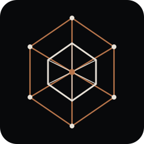

# ORTHEON

<strong>UNIVERSAL STRUCTURAL COMPUTATION</strong> The science of representing, analyzing and verifying structure.

  
  
  
  

---

ORTHEON is a Rust-first research framework for representing formal structures and running deterministic structural analyses. Its initial computational substrate is a typed, deterministic graph model with validation, traversal, connectivity analysis, topological ordering and content fingerprints.

The long-term research direction is broader: a common computational architecture for relations, graphs, hypergraphs, constraints, transformations, dynamics, inference and optimization. The current implementation is deliberately narrower than that ambition. Implemented capabilities are documented as such; proposed research directions are not presented as working features.

## Why ORTHEON exists

Complex systems are studied through many different mathematical representations. ORTHEON explores a practical question:

> What shared computational foundations can support rigorous analysis across different kinds of structure without erasing their domain-specific semantics?

The executable kernel now includes three distinct finite structural models: graphs, hypergraphs and binary relations. They retain their own semantics rather than being flattened into one representation.

## Current capabilities

| Area | Status | Available functionality |
|---|---|---|
| Graph representation | Implemented | Directed and undirected labeled graphs |
| Hypergraph representation | Implemented | Native n-ary hyperedges and incidence validation |
| Finite relations | Implemented | Carrier validation, domain/range, inverse, composition, relation properties, transitive and reflexive-transitive closure |
| Validation | Implemented | Endpoint, identity and representation invariants |
| Fingerprinting | Implemented | SHA-256 fingerprint of canonical graph encoding |
| Traversal | Implemented | Deterministic reachability and unweighted shortest paths |
| Connectivity | Implemented | Undirected components, directed weak components, directed strongly connected components, and hypergraph components |
| Topology | Implemented | Degree statistics, topological ordering, bipartition testing and graph complement |
| Cycle handling | Implemented | Cycle detection through Kahn's algorithm |
| CLI | Implemented | Reproducible demonstration and graph inspection |
| Formal proofs | Planned | Coq specifications and verified core properties |
| Hypergraphs and algebraic structures | Planned | Domain-specific representations |
| Reconstruction | Implemented baseline | Adjacency-matrix reconstruction and induced subgraphs |\n| Structural inference | Implemented heuristic | Missing-edge candidates ranked by common-neighbor count; not causal inference |\n| Optimization | Implemented baseline | Kruskal minimum spanning forest for caller-supplied nonnegative integer weights |\n| Dynamics | Research direction | Not yet implemented |
| Python, WebAssembly and Explorer | Planned | Interfaces after API stabilization |

## Quick start

Requirements: stable Rust toolchain.

~~~bash
git clone https://github.com/DT-09/Ortheon.git
cd Ortheon
cargo test --workspace
cargo run -p ortheon-cli -- demo
cargo run -p ortheon-cli -- inspect
cargo run -p ortheon-cli -- analyze data/edges.txt undirected
~~~

Use the library:

~~~rust
use ortheon_core::Graph;

fn main() -> Result<(), Box<dyn std::error::Error>> {
    let mut graph = Graph::directed();
    graph.add_node(1, "source")?;
    graph.add_node(2, "transform")?;
    graph.add_node(3, "result")?;
    graph.add_edge(1, 2)?;
    graph.add_edge(2, 3)?;
    graph.validate()?;
    println!("fingerprint: {}", graph.fingerprint());
    println!("topological order: {:?}", graph.topological_order()?);
    println!("reachable from 1: {:?}", graph.reachable_from(1)?);
    Ok(())
}
~~~

## Architecture

~~~text
ORTHEON
├── Mathematical substrate: graphs, n-ary hypergraphs, finite binary relations
├── Structural algorithms: traversal, connectivity, SCCs, bipartition, reconstruction, inference, spanning forests, relation closure
├── Evidence: validation, deterministic fingerprints, repeatable tests
├── Interfaces: Rust library and CLI demo, inspection and edge-list analysis
└── Research extensions: relations, hypergraphs, topology, inference,
    reconstruction, transformations, dynamics, optimization, formal methods
~~~

The core library has no dependency on the CLI or visualization. The CLI consumes the public library API.

## Algorithmic contracts

| Operation | Expected complexity | Notes |
|---|---:|---|
| Add node / edge | O(log V) / O(log E) | Ordered maps and sets |
| Validate | O(V + E) | Checks stored endpoints |
| Fingerprint | O(V log V + E log E) | Canonical ordered encoding |
| Reachability (Graph method) | O(VE) | Baseline scan implementation |\n| Shortest path | O(V + E) | Adjacency-indexed breadth-first search |\n| Components / SCC / bipartition | O(V + E) | Adjacency-indexed traversal |\n| Minimum spanning forest | O(E log E + V α(V)) | Kruskal with disjoint-set union |
| Components | O(VE) | Baseline scans edges per visited vertex |
| Degree statistics | O(V + E) | Directed in/out or undirected degree |
| Topological order | O((V + E) log V) | Directed acyclic graphs only |
| Relation composition | O(|R| × |S|) | Baseline pair matching over finite relations |
| Relation closure | O(n³) | Warshall algorithm over an n-element carrier |\n| Common-neighbor inference | O(V² log V + E) | Deterministic local structural heuristic |

V is the number of vertices and E the number of edges. These are complexity expectations, not benchmark claims.

## Research boundaries

A graph fingerprint is not a graph-isomorphism certificate. Equal fingerprints establish equality of the canonical labeled representation used here; they do not establish equivalence under arbitrary relabeling.

Weak connectivity in a directed graph ignores edge direction. It does not establish strong connectivity. Topological ordering applies only to directed acyclic graphs. A cycle produces an explicit error.

The project does not currently claim causal discovery, universal reconstruction, graph or hypergraph isomorphism, formal proof of the Rust implementation, weighted shortest paths, or general-purpose optimization.

## Repository map

- crates/ortheon-core — structural data model and algorithms.
- crates/ortheon-cli — command-line demonstration.
- docs/architecture.md — architecture and dependency boundaries.
- docs/research-agenda.md — research programme and open questions.
- docs/verification.md — validation strategy.

## Contributing

See CONTRIBUTING.md. New algorithms require a precise contract, complexity analysis, deterministic tests where applicable, and documentation of assumptions and failure modes.

## Citation

See CITATION.cff. Until a research publication exists, cite the repository and exact release or commit used.

## License

MIT. See LICENSE.
